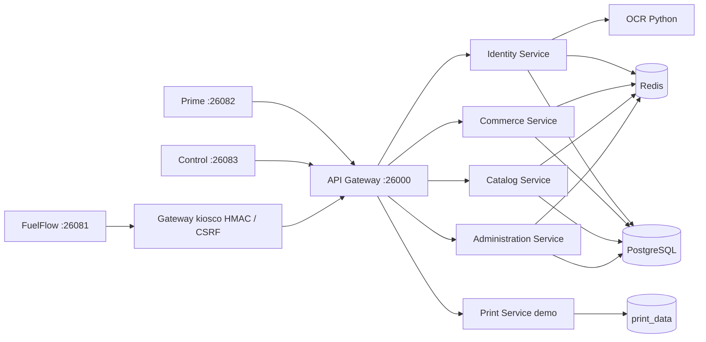
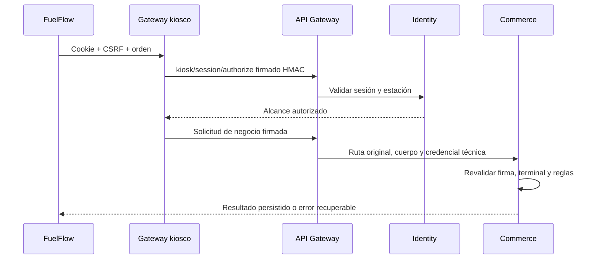
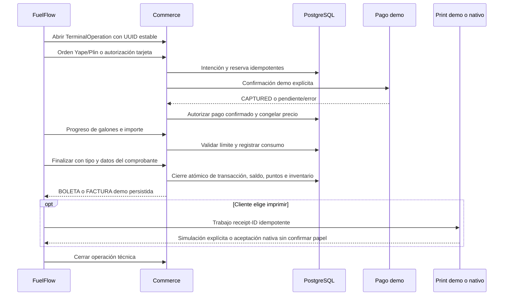

# Arquitectura implementada

## Aplicaciones y comunicación

HTTP con DNS interno, timeout de 15 segundos y ninguna repetición automática de
mutaciones. El gateway conserva ruta/cuerpo firmados, cookies, Bearer y
`X-Request-Id`. OCR tiene timeout de 12 segundos. No hay broker ni Kubernetes.

## Propiedad de datos y límites

| Aplicación | Entrada | Datos y responsabilidad efectiva |
| --- | --- | --- |
| Identity | `src/apps/identity/main.ts` | User, Membership/perfil, Vehicle, PasswordReset, sesiones y credenciales kiosco |
| Catalog | `src/apps/catalog/main.ts` | Lecturas Fuel, Station, FuelInventory y Benefit |
| Commerce | `src/apps/commerce/main.ts` | Payment, OnlineOrder, eventos, FuelAuthorization, Transaction/comprobante, deuda, saldo, puntos, canjes, reservas, consumo, TerminalOperation y asistencia |
| Administration | `src/apps/administration/main.ts` | Cuentas Control, grants, asignaciones, auditoría; recepción/conciliación de stock y estados de terminal |
| OCR | `PlateRecognition/app.py` | Procesamiento transitorio, sin guardar imágenes |
| Print demo | `PrintAgent/demo-server.mjs` | Comprobantes demo y trabajos idempotentes; no modifica pagos |

Transición con esquema compartido `public`, FK e integridad conservadas; no hay
bases privadas por servicio. Commerce actualiza saldo de Membership y reservas
dentro de la venta; Identity lee deuda, puntos e historial; Control consulta y
gestiona varios dominios bajo permisos/auditoría. Son dependencias SQL reales,
no comunicación REST. Separar esquemas requerirá proyecciones de lectura, APIs
de comandos por propietario y coordinación distribuida antes de migrar datos.

AuthCoreModule comparte guardas/proveedores, sin publicar login en cada proceso.
AuthModule publica identidad solo en Identity. El monolito anterior queda para
pruebas históricas y no se inicia en Compose. Se agrupan pagos, puntos y recibos
para conservar el cierre SQL atómico; no se crean diez procesos artificiales.

## Compra, pago y comprobante

Postpago reserva saldo Prime antes del despacho y liquida consumo según reglas
existentes. No excede el monto autorizado. Yape/Plin pendientes no habilitan
despacho; errores se concilian mediante estados/eventos. PostgreSQL mantiene
operaciones serializables, bloqueos, UUID únicos y reintentos acotados.

El comprobante tiene un registro `Receipt` único por Transaction, con serie,
correlativo, número y fecha inmutables. PostgreSQL lo asigna atómicamente al
guardar la venta; cliente y Control consultan el mismo registro. No existe un emisor fiscal independiente.
Imprimir no condiciona el resultado financiero. Print demo valida el contrato
térmico y devuelve `simulation:true, physicalConfirmed:false`; no es emisión SUNAT.

## Fallos y despliegue

Cada dominio escucha en 3000 y expone `/api/v1/health` con consulta PostgreSQL y
Swagger propio. OCR usa 8000, Redis 6379 y PostgreSQL 5432, sin puertos públicos.
Un catálogo detenido produce 502 en sus rutas y salud agregada 503; otras rutas
siguen siendo enrutables. PostgreSQL es una dependencia común de disponibilidad.

La credencial técnica se reutiliza en el navegador. Un gateway confiable puede
reemplazarla solo en una terminal ociosa, revocando la anterior y auditando la
emisión; una operación abierta bloquea el reemplazo. Se conserva su historial.

Orden automático: PostgreSQL saludable → migraciones → seed base → seeds de
Control/operación → dominios → gateway → frontends. OCR e impresión tienen salud
propia. Servicios permanentes: `unless-stopped`; migraciones y seeds: tareas únicas.
Volúmenes persistentes de PostgreSQL, Redis e impresión. Para validar desde cero
se usa otro nombre Compose; nunca se elimina un volumen preexistente.

Consultar README para arranque, cuentas, variables, logs, parada y pruebas.
Las configuraciones históricas de Infrastructure y overrides Compose requieren
revisión antes de aplicarlas a este demo; no describen automáticamente esta
arquitectura. Se conserva `Docs/` para respetar la estructura documental existente.
