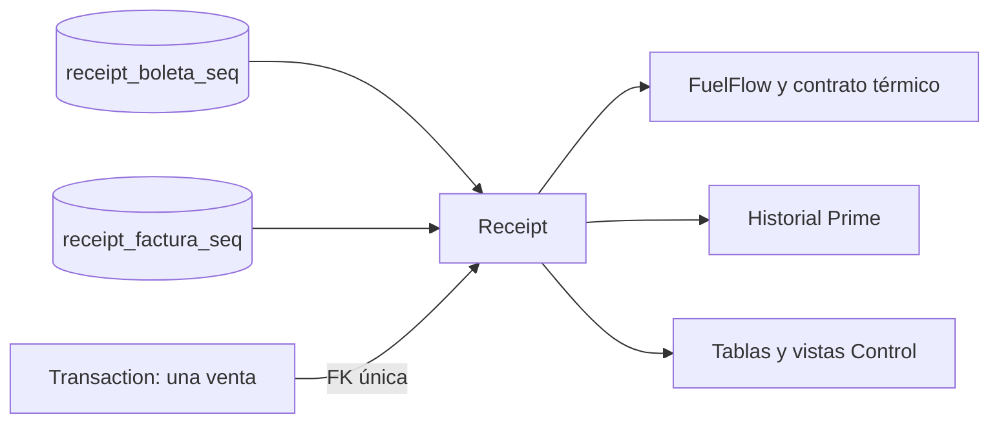

# Integración de frontends y comprobantes correlativos

Actualización del 7 de noviembre de 2026 (pruebas completadas el 8 de noviembre
UTC, todavía 7 de noviembre en Lima). Este documento describe los cambios
posteriores a la primera separación del backend en aplicaciones independientes.

## 1. Disponibilidad de FuelFlow

FuelFlow no requiere entrar a Control. El seed crea la terminal demo disponible,
Prisma/PostgreSQL usan `DISPONIBLE` por defecto y el antiguo estado administrativo
`BLOQUEADA` no autoriza ni deniega nuevas atenciones. Control muestra un indicador
de solo lectura: se retiraron sus botones y el manejador de habilitar/suspender.
El endpoint anterior conserva una respuesta 409 explícita y no modifica datos.

Se mantienen las validaciones de firma HMAC, sesión técnica, estación, ciclo de
vida, asignación de surtidor activo, operación única, pago, límites de despacho,
inventario e intervención. `ASISTENCIA`, `FUERA_DE_SERVICIO` y una terminal
revocada siguen bloqueando nuevas operaciones cuando representan una condición
real. Resolver una intervención segura permite volver a atender sin otro botón
de habilitación; no se elimina la conciliación financiera.

Compatibilidad: una migración retira bloqueos administrativos anteriores con
auditoría. Si quedó una atención vacía suspendida por el antiguo interruptor,
solo se cierra automáticamente cuando existe evidencia de aquella suspensión,
hay surtidor activo, no hay incidencia abierta y no existe autorización, pago,
orden, venta ni reserva asociada. Una venta real pendiente no se cancela.

## 2. Logos seleccionados

- Prime: `Frontend_2_PrimaxPrime/assets/Logotipo corporativo PRIMAX PRIME.png`.
- Control: `Frontend_3_PrimaxControl/assets/Logotipo Primax Control en azul y naranja.png`.

La identidad de ambos archivos es inequívoca por nombre y contenido. No se
descargaron, generaron, recortaron ni editaron imágenes. Se conservaron las
eliminaciones previas de `primax.jpg` que ya estaban en el directorio al empezar.
Se actualizaron login, registro, encabezado y navegación lateral correspondientes.
CSS conserva la proporción mediante altura automática y `object-fit: contain`.
Los Dockerfiles ya copian las carpetas assets completas.

## 3. Modelo y emisión

`Receipt` es un registro distinto del ID de la venta:

| Campo | Uso |
| --- | --- |
| `id` | Identificador interno del comprobante y del trabajo de impresión |
| `transactionId` | FK única a la transacción, con borrado restringido |
| `documentType` | BOLETA o FACTURA |
| `series` | EB01 o FT01 |
| `correlative` | bigint persistente; la API lo devuelve como cadena |
| `number` | Número completo único: EB01-0001 / FT01-0001 |
| `issuedAt` | Fecha efectiva de asignación, inmutable |
| `legacy` | Identifica la asignación a una venta anterior a esta migración |

El dominio comercial conserva su responsabilidad sobre comprobantes. Al insertar
una transacción, un trigger PostgreSQL emite su registro dentro de la misma
transacción SQL. `receiptResponse` centraliza su contrato JSON; ningún frontend
solicita ni calcula el siguiente número. Consultar o reimprimir solo lee.

Las secuencias PostgreSQL independientes usan `nextval`, son seguras ante
concurrencia y no se reinician con contenedores. El formato utiliza al menos
cuatro dígitos sin truncar: después de 9999 sigue 10000. Un rollback puede dejar
un hueco: ese valor se considera reservado y no se reutiliza. No se promete una
secuencia sin huecos después de errores.

La unicidad de `operationId` conserva la idempotencia de venta; `transactionId`
único impide un segundo comprobante, y `(series, correlative)` y `number` tienen
restricciones únicas. Triggers impiden modificar/borrar registros emitidos y
cambiar el tipo de documento de una venta existente. Cambiar el estado financiero
por reembolso conserva el comprobante y su número.

## 4. Migración de datos existentes

Se inspeccionó la base demo antes de migrar: había dos ventas (una boleta y una
factura), con tipo e identidad fiscal pero sin campos de número/serie ni tabla
de comprobantes. No había correlativos persistidos que conservar o sobrescribir.

La migración añade un Receipt por venta anterior, ordenando por fecha e ID,
marcado `legacy=true`. Su fecha de emisión corresponde a esta asignación, sin
inventar una emisión fiscal histórica. Las dos ventas recibieron EB01-0001 y
FT01-0001. Sus IDs y el hash MD5 de cada fila completa permanecieron idénticos
antes/después de la migración: no cambiaron importes, precios ni datos originales.

Los documentos emitidos después tienen `legacy=false`. Las migraciones son
transaccionales y Prisma registra su aplicación; `migrate deploy` no las repite
al reiniciar. No usar `prisma db push` para sustituir estas migraciones: los
triggers y las secuencias son parte deliberada del contrato PostgreSQL.

## 5. Integración de las tres interfaces

- FuelFlow muestra el número asignado en el resumen y lo envía al imprimir.
- Prime conserva el objeto `receipt` del backend y muestra su número en el
  detalle de consumo, separado de la referencia interna de transacción.
- Control muestra tipo y número en transacciones, número en operaciones e
  historial de cliente, detalle y vista previa. Una autorización sin venta
  muestra `Sin comprobante`, sin fabricar un identificador.
- Las consultas administrativas y los historiales utilizan el mismo registro
  persistido, con sus permisos y filtros anteriores.

El contrato térmico v2 admite, de manera compatible, `number` y `transactionId`.
Las representaciones nuevas usan el ID del Receipt para el trabajo, evitando
colisiones con trabajos históricos cuyo ID era el de la venta. El adaptador
nativo conserva ambos campos e imprime el número; los contratos antiguos sin
numeración siguen siendo válidos como documentos históricos sin número.
La impresión demo guarda el trabajo con el número recibido y no imprime papel.
Finalizar sin imprimir sigue cerrando la operación y conserva el Receipt.

Todos estos documentos son académicos y no tienen validez de emisión SUNAT.

## 6. Docker y pruebas

El comando sigue siendo `docker compose up -d`. Los servicios construibles usan
`pull_policy: build` para reconstruir con caché las fuentes actuales, incluidos
assets, migraciones y contrato de impresión, sin exigir `build` manual.
Se conservaron volúmenes y el orden PostgreSQL → migración → seeds → aplicaciones.

Resultados ejecutados:

| Verificación | Resultado |
| --- | --- |
| Backend unitario | 218 pruebas aprobadas |
| PostgreSQL integración, incluidos correlativos | 310 pruebas aprobadas |
| FuelFlow / Prime / Control | 144 / 28 / 27 pruebas aprobadas |
| PrintAgent y contratos nativos con mocks | 56 pruebas aprobadas |
| Gateway / OCR | 23 / 12 pruebas aprobadas |
| TypeScript y ESLint | Sin errores |
| Compose principal y migraciones automáticas | Inicio correcto, 13 servicios saludables |
| Copia limpia, imágenes sin caché, base nueva | Inicio correcto sin archivos locales adicionales |

Total: **818 pruebas distintas**. Los 45 casos omitidos por configuración
en el primer grupo general se ejecutaron en sus perfiles específicos; no se
cuentan como pruebas pendientes. El nuevo test de comprobantes verifica tres
documentos por serie, intercalado, 24 inserciones concurrentes, replay, rollback,
reembolso, inmutabilidad y ambas series más allá de 9999.

Pruebas funcionales adicionales:

- FuelFlow obtuvo sesión preparada antes de cualquier login Control y respondió
  200 con FrontEnd_3 detenido; después se restauró el dashboard.
- Tras reiniciar todos los contenedores del laboratorio, EB01 mantuvo máximo 2
  y dos registros; la siguiente venta pública recibió EB01-0003.
- El número se comparó entre API, venta, historial Prime, tabla Control y envío
  de impresión. En navegador se emitió FT01-0002 y se cerró sin imprimir; para
  EB01-0002 se capturó el POST real de impresión y coincidió con la pantalla.
- Control mostró EB01-0002 y FT01-0002 después de recargar la página; Prime mostró
  EB01-0002 en el detalle de movimiento.
- Ambos logos cargaron desde Docker a 1280 y 375 px de ancho, con proporción
  conservada, `contain` y sin desbordamiento horizontal.

## 7. Archivos principales del cambio

- `compose.yaml`, `README.md`, especificaciones actuales y este documento.
- `Backend/prisma/schema.prisma` y las tres migraciones `20261107000000`,
  `20261107010000`, `20261107020000`.
- `Backend/src/receipts/receipt.service.ts`, `transactions/transaction.model.ts`
  y `common/response.dto.ts`.
- `Backend/src/operations/{terminal-availability.ts,operations.service.ts}`, la
  integración `kiosk/kiosk.service.ts` y `scripts/seed-local-operations.cjs`.
- `Backend/src/control/{control-customers.service.ts,control-operations.service.ts}`.
- Tests de comprobantes, disponibilidad, Control y numeración térmica; smoke público.
- FuelFlow: `src/index.html`, `src/js/{script.js,thermalReceipt.js}`.
- Prime: `index.html`, `js/{app.js,login.js,register.js,services/index.js}` y CSS.
- Control: `js/app.js` y `styles/control.css`.
- PrintAgent: `contract.mjs` y `ThermalLayout.cs`.

Se conservaron los cambios anteriores del repositorio. No se hizo push ni se
eliminaron datos o volúmenes. La impresora USB y el papel real, un surtidor físico,
la APK instalada y la emisión fiscal/comercial no fueron verificados. Se comprobó
la impresión simulada y el contrato enviado al agente, no una impresión física.
