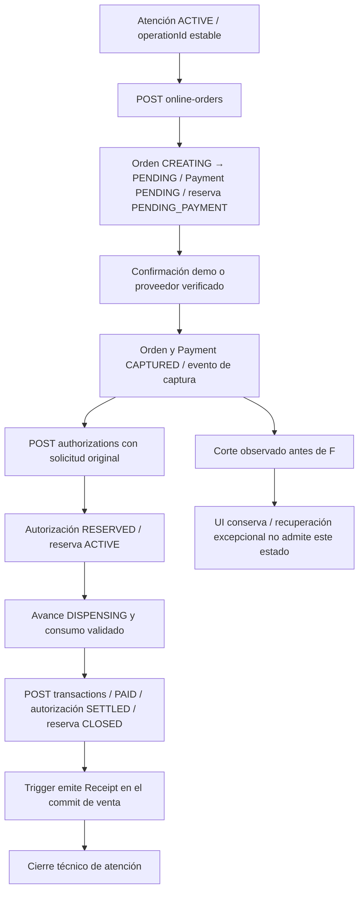

# Lote 5 — diagnóstico final de CAPTURED sin venta

Fecha: 20/11/2026. Referencia: `c1184c1f5a7416830f3e1c281ee14bb0bf40a9ef`; rama `feat/dezkz-identity-a4-core`. **Solo diagnóstico, documentación y pruebas aisladas. Ninguna corrección financiera implementada. Lote 5 abierto.**

## Causa raíz y severidad

La continuidad se interrumpe **después de confirmar la captura y antes de solicitar autorización de despacho**. Son fases con commits/peticiones distintas. CAPTURED confirma pago, no combustible despachado: no activa por sí solo la reserva ni crea autorización, venta o comprobante. La UI ordinaria conserva CAPTURED tras recarga; la recuperación excepcional admite PENDING_PAYMENT íntegro o SETTLED_SALE completo y excluye el estado intermedio. Control ofrece solo ESCALATE. Los bloqueos son conservadores, pero no proporcionan continuidad para completar el servicio ya pagado.

**P1 funcional con impacto financiero/operativo.** Puede quedar un pago capturado, inventario comprometido y atención bloqueada sin prestación/comprobante. No se acreditó duplicación, corrupción global, autorización cruzada ni P0 nuevo en el alcance ejecutado. Eso no certifica ausencia universal de P0. T01 histórica tiene venta/autorización/recibo ya liquidados y es otro caso; no se intervino.

## Flujo financiero actual

Este diagrama describe el código existente; no se ejecutaron las fases de autorización/venta para rescatar un CAPTURED en esta sesión.

`OnlineOrdersService.create` conserva intención SQL antes del efecto de proveedor: Payment PENDING, reserva física PENDING_PAYMENT y orden por operationId único. Después crea la orden remota. Una incertidumbre no habilita un nuevo cobro automático. `confirmDemo` valida entorno demo, importe y moneda; el proveedor demo conserva transición paid idempotente. `status` verifica referencia, importe, PEN, paid y paid_at positivo; bajo bloqueo confirma Payment/OnlineOrder CAPTURED y un evento `capture:<orderId>`. **No llama a creación de autorización o venta.**

`AuthorizationsService.createPrepaidV12_1` contiene la continuación ordinaria: exige solicitud compatible, mismo operationId, contexto técnico activo, estación/combustible/precio válidos, pago y reserva concordantes. Para YAPE/PLIN reutiliza el Payment existente, exige orden CAPTURED y no entra en authorizeDemo. En su transacción activa reserva y crea autorización RESERVED. Esta ruta es potencialmente reutilizable, pero no se invocó aquí.

El avance exige autorización/reserva activas y precio autorizado. `TransactionsService.create` exige authorizationId y consumo coherente; no inicia otro pago al cerrar prepago. Liquida autorización, crea venta/vínculos/puntos/perfil y cierra reserva en su unidad existente. El trigger SQL emite Receipt al insertar Transaction. El cierre técnico posterior rechaza pago/orden sin autorización conciliada y reservas pendientes. No existe atomicidad global entre proveedor, SQL, Redis y todas las peticiones; un corte entre fases no demuestra rollback SQL defectuoso.

## Contratos, correlación y mecanismos existentes

Fuentes inspeccionadas: [online-orders.ts](../../Backend/src/payments/online-orders.ts) (create 84, confirmDemo 156, status 290 y evento de captura 372), [authorizations.service.ts](../../Backend/src/transactions/authorizations.service.ts) (createPrepaidV12_1 689), [transactions.service.ts](../../Backend/src/transactions/transactions.service.ts), [operations.service.ts](../../Backend/src/operations/operations.service.ts) (closeOperation 222 y resolveOperation 356), [kiosk.service.ts](../../Backend/src/kiosk/kiosk.service.ts) (recoveryEvidence 278, ticket 332 y scope 563), [control-payments.ts](../../Backend/src/operations/control-payments.ts), [script.js](../../Frontend_1_FuelFlow/src/js/script.js) (guardas 1392/1433), [transactionsService.js](../../Frontend_1_FuelFlow/src/js/transactionsService.js) (reconcile 112), [recoveryDesk.js](../../Frontend_1_FuelFlow/src/js/recoveryDesk.js) y [trigger existente](../../Backend/prisma/migrations/20261107000000_receipt_numbering/migration.sql) (47). Ninguna de estas fuentes se modifica.

operationId correlaciona atención, orden, pago, reserva, autorización y venta con sus restricciones únicas y relaciones. OnlineOrder.requestHash compara el DTO original completo; Payment.requestHash y la reserva comparan la autorización normalizada. **Son checksums distintos y no se invierten para reconstruir datos perdidos.** La sonda de solo lectura comprobó ambos usando el DTO real compilado: coincidieron precio, contexto, importes y relaciones.

El proveedor demo retorna sin otra transición si ya está paid. La captura SQL bloquea la orden y retorna si ya estaba CAPTURED. GET online-orders puede conciliar/escribir cuando hay resultado pendiente; **para CAPTURED retorna inmediatamente el estado persistido**. Las nuevas lecturas concurrentes se limitaron a ese caso. Autorización/venta tienen replay propio; el Map in-flight es local al proceso y la unicidad/atomicidad SQL proporciona protección persistente. Nada de ello sustituye autorización o consumo ausentes.

| Mecanismo / actor | Alcance vigente | CAPTURED sin autorización/venta |
|---|---|---|
| FuelFlow ordinario | Reconstruye PENDING/CREATING con ID, catálogo/flags/QR | iniciar conserva y pide asistencia cuando lee CAPTURED |
| transactionsService.reconcile | Requiere payload de venta; consulta autorización y puede recuperar SETTLED con replay | Sin payload devuelve action=empty, no descubre ni crea autorización |
| POST authorizations ordinario | Autoriza un pago capturado con solicitud/contexto válidos | Reutilizable solo bajo condiciones existentes; produciría una autorización real, no un cambio visual |
| Control GET payments/:id | id corresponde a operationId; permisos/estación | SUPER_ADMIN nuevo recibió allowedActions=[ESCALATE]; ninguna acción de continuación |
| Control RETRY | Orden PENDING/CREATING; consulta status | Concilia pago, no autoriza despacho/venta; no disponible aquí |
| Ticket excepcional | SUPER_ADMIN global, grants, motivo, terminal/operación válidas, sin credencial ordinaria vigente y evidencia estricta | Solo PENDING_PAYMENT o SETTLED_SALE íntegros; excluye CAPTURED intermedio |
| Credencial recuperada / recoveryDesk | Una atención, cancelación de su orden PENDING o cierre conciliado | No permite autorizaciones/ventas nuevas; cancel=false y close=false para el huérfano |

El laboratorio aún tenía credencial ordinaria vigente: no se pidió ticket ni se revocó una credencial para alcanzar otro guard. Se invocó exclusivamente `recoveryEvidence` real del artefacto Commerce sin modificar, en PostgreSQL **READ ONLY**: devolvió 409 «Estado financiero no apto para recuperación». Esto comprueba la exclusión financiera, no permisos ni emisión pública de ticket. GET recovery-state con credencial ordinaria devolvió el 403 esperado por faltar scope de recuperación.

## Cuatro situaciones diferentes

| Situación | Evidencia / diagnóstico |
|---|---|
| Respuesta de confirmación perdida | Servidor puede tener paid/CAPTURED y cliente solo fallo de red. Consultar misma orden para conocer resultado; no asumir fracaso ni capturar otra vez |
| ID local perdido | SQL conserva enlaces por operationId y Control puede localizar orderId. Identificarlo no concede autoridad para despachar; la UI bloquea si falta evidencia local |
| Proveedor desconocido o rollback de captura | Intención CREATING/PENDING y posible reserva REVIEW; status/findByReference pueden conciliar con prueba autoritativa. Evidencia previa reutilizada, no nuevas operaciones de proveedor |
| CAPTURED conocido sin autorización | Pago persistido, reserva PENDING_PAYMENT y cero consumo/venta/recibo. No falta el pago ni necesariamente el ID: falta continuidad admitida para el estado intermedio |

## Verificaciones nuevas

Laboratorio exclusivo `primax-astra-lot5-captured-225b19f745`, puertos loopback 27900/27981–27984, PostgreSQL/Redis, cuatro volúmenes y dos redes nuevos, secretos aleatorios e imágenes propias de c1184c1. Bootstrap aplica solo la cadena existente de 36 migraciones; ninguna migración nueva. No se usaron volúmenes ni bases de instalaciones anteriores.

1. Chromium real: T02 → Regular → PREPAGO 20 → BOLETA → DGN-601 sintética → YAPE: una orden PENDING.
2. Se confirma **una vez el pago nuevo**. El proxy deja que el backend responda 201/CAPTURED y descarta esa respuesta antes de entregarla al navegador. El cliente ve resultado desconocido y no solicita autorización/venta. No se vuelve a pulsar confirmar ni a reenviar demo-confirm.
3. Recarga conserva operación y muestra asistencia por CAPTURED. Tres GET concurrentes devuelven misma orden/pago, sin cambios financieros.
4. Se elimina solo onlineOrderId del localStorage sintético: la UI bloquea por pago/reserva existente. Se repone el snapshot local original para preservar evidencia, sin editar SQL/Redis ni ejecutar otra acción financiera.
5. Control login sintético y GET: SUPER_ADMIN con permiso, solo ESCALATE. No se ejecuta esa acción; cookie privada.
6. Predicado backend real en READ ONLY: 11 checks de correlación/hashes/contexto/proveedor paid pasan y admisión devuelve 409. Sin llamadas de creación de autorización/venta, tickets, cancelaciones, reembolsos o compensaciones.
7. Cuatro pruebas puras en Node 22, sin red/fuente de solo lectura: acciones de huérfano CAPTURED, PENDING, venta liquidada histórica con/sin recibo y reconcile sin payload. **4/4**, sin ejecutar acciones financieras.

| Estado final nuevo, conservado | Resultado |
|---|---|
| operationId / atención | `1481803d-95fd-43e6-8cac-bb5777246226` / ACTIVE |
| Orden / pago | `05981005-2522-4b87-bc70-9a10929c014e` / `0826268c-afb2-4b80-9314-eeba85a0f0e7`, CAPTURED, 20, DEMO |
| Autorizaciones / ventas / comprobantes | 0 / 0 / 0; secuencias boleta/factura sin utilizar |
| Reserva | PENDING_PAYMENT, 3.554972 L restantes, cero consumidos/liberados |
| Stock Regular | 5000 L físicos y 3.554972 L reservados |
| Eventos | DEMO_PENDING, DEMO_PAID y un CAPTURED; sin segunda captura |
| Infraestructura | PostgreSQL 17.6, 36 migraciones, cero FK sin validar; Redis PONG |

Snapshots SQL completos idénticos tras captura, lecturas concurrentes, pérdida de ID y sondas. Redis conserva controles temporales: sesión autenticada 1800 s, owner ordinario 120 s renovable, binding operación/estación 604800 s; credencial SQL ordinaria 8 h. Expirar un TTL no convierte CAPTURED en venta ni libera esa reserva. Variaron conteos/TTL por expiración natural, sin borrado manual. No se ensayó una caída de Redis ni recuperación productiva de su almacenamiento.

Preparación del harness: el primer acceso de navegador precedió al arranque healthy y se repitió cuando estuvo listo; no fue un fallo del producto. Una sonda preparada inicialmente en Identity carecía del DTO Commerce, y se corrigió la herramienta para ejecutarla en Commerce. No se cambiaron módulos/servicios ni se creó efecto financiero adicional para resolver esos errores de preparación.

## Reutilización sin repetir acciones prohibidas

Se recompararon seis pares canónicos: orders 95 checks/brazo, authorizations 107, sale-regression 38, recovery 41, terminal 61 y control-payments 36: **756 checkpoints históricos reutilizados**, no nuevos. Backend no cambia desde 9d57ede; se conservaron campos financieros. Se verificó también igualdad SQL del CAPTURED antes/después de la confirmación repetida registrada en c1184c1.

Respaldan concurrencia de creación/captura/callback, respuesta perdida, rollback/replay y scopes. Algunas familias contienen cancelaciones/reembolsos de etapas anteriores: **no se ejecutaron otra vez**. La concurrencia nueva fue solo de lecturas CAPTURED, no una nueva carrera de escrituras. No se repitieron las 3526 comprobaciones globales ni las 186+24 aceptadas del parche; no se certifican proveedores comerciales.

## Alternativa recomendada, no implementada

**Conservar bloqueo y revisión asistida explícita; diseñar primero el caso estrecho de continuación del mismo despacho con sesión/contexto originales íntegros, reutilizando el motor ordinario y sin nueva captura.** No emitir una venta directamente ni reparar tablas.

Antes de una futura acción: credencial/owner vigentes y reclamados correctamente, misma terminal/surtidor/estación activos, solicitud original íntegra/checksums compatibles, pago CAPTURED no reembolsado y enlaces únicos, cero autorización/venta/consumo, reserva coherente y precio/identidad elegibles según reglas vigentes. Confirmación expresa de continuar el suministro y revalidación backend antes del efecto. La consistencia comprobada hoy **no autoriza a ejecutar esa continuación**.

- Existe motor legítimo reutilizable: POST authorizations seguido de avance/venta/cierre originales. Para YAPE/PLIN CAPTURED reutiliza Payment sin otra llamada de cobro. Es una conclusión de código y lectura, no una autorización creada en la prueba.
- Sí habría un efecto financiero futuro: **una autorización real** sobre la misma atención y luego suministro validado. No hace falta una primitiva de captura nueva, pero sí autorizar la orquestación de recuperación. No es una continuación sin efectos financieros.
- Sin sesión/owner/solicitud íntegros: mantener bloqueo. No copiar UUID del administrador, invertir hashes o usar x-kiosk-key legacy como bypass. El ticket existente no concede despacho; ampliar evidencia/scope exige otro diseño y permiso de seguridad, no agregar a ciegas un estado al predicado.
- Si no puede acreditarse continuación segura o no se prestará servicio: decisión de conciliación de negocio separada y autorizada. No se elige ni ejecuta devolución, compensación o cierre forzado en este diagnóstico.

### Alcance de una futura corrección

| Caso | Archivos/capas candidatos | Límite |
|---|---|---|
| Sesión ordinaria íntegra | FuelFlow script.js y pruebas; transactionsService solo si se requiere conservar solicitud exacta | Acción explícita/revalidada con IDs existentes; no cambiar motores/contratos si basta ruta ordinaria |
| Elegibilidad/orquestación ampliada | Commerce application/use-cases, puerto tipado y adaptador local a motores actuales | Otro alcance autorizado; un ejecutor, sin escritor paralelo ni execute(any) |
| Recuperación excepcional sin sesión | KioskService/scope, recoveryDesk y contratos solo si se aprueban | Revisión de seguridad separada; AuthCore no se modifica implícitamente |
| Contexto que no pueda probarse con datos existentes | Diseño de procedencia/almacenamiento, migración solo con autorización adicional | No se plantea una migración obligatoria para el caso estrecho ni se inventa contexto hoy |

Compatibilidad hexagonal: OrderWorkflow/TX08 confirma pago; AuthorizationCommands/TX06 autoriza; CreateTransaction/TX05 y triggers/TX13 cierran venta; TerminalWorkflow/ControlOperationRecovery/TX12 conservan atención/permisos. Mantener unidades actuales y un ejecutor, sin dividir por RPC ni duplicar autoridades. Base compartida y adaptadores legacy siguen explícitos; no se declara autonomía productiva.

Archivos concretos de frontera para revisar si se autoriza un alcance ampliado: `Backend/services/commerce/src/application/use-cases/authorization-commands.ts`, `application/ports/authorization-commands.ts` y `adapters/outbound/existing-authorization-commands.ts`; para recuperación excepcional, `application/use-cases/control-operation-recovery.ts` y KioskService. Son candidatos de diseño, no archivos cambiados ni permiso para alterar políticas. El caso estrecho comenzaría en `Frontend_1_FuelFlow/src/js/script.js`; cualquier necesidad de modificar motores/contratos/scope debe evaluarse y autorizarse expresamente antes de implementarla.

### Pruebas necesarias después de autorizar

1. Cortes entre paid/captura SQL/autorización/respuesta de autorización: mismos IDs, cero capturas nuevas y una autorización como máximo.
2. Confirmación explícita, doble click/carreras entre pestañas/procesos; mismo operationId con otro payload debe rechazar sin efectos nuevos.
3. Reservas PENDING_PAYMENT/ACTIVE/REVIEW/CLOSED, consumo cero/parcial, descuentos/precio cambiado, stock insuficiente, refund existente y proveedor ambiguo: conservar/rechazar, no inventar éxito.
4. Pérdida de ID/snapshot/owner/sesión, expiración/revocación, actor o estación ajenos, tickets fuera de scope y cambio de estado entre revisión y confirmación.
5. Avance/venta con respaldo real y replay ante respuesta perdida: comprobante, stock, puntos/ledger, relaciones y secuencias; cerrar atención solo después de conciliación.
6. Cualquier otra acción de conciliación se prueba y autoriza separadamente. Elegibilidad de reembolso no equivale a permiso de ejecutarlo.

## Entrega y detención

Comprobación reproducible sin servidor: `docker run --rm --network none --mount "type=bind,source=$($PWD.Path),target=/work,readonly" --workdir /work --entrypoint node primax-astra-stage2-validation:test --test tools/astra/lot5-captured-predicates.mjs`. El [auditor](../../tools/astra/lot5-captured-audit.cjs), `node tools/astra/lot5-captured-audit.cjs`, vuelve a verificar artefactos, fuentes previas, nueve hashes, ausencia de efectos financieros adicionales y contenedores/volúmenes mediante lecturas; requiere `.cache` privado conservado para cotejar hashes y configuración, no lo publica. [Resultado de auditoría](evidence/lot5-captured-diagnostic/review-summary.json). Las herramientas `lot5-captured-diagnostic.cjs` y `lot5-captured-readonly-probe.cjs` preservan el aislamiento y el predicado READ ONLY; crear otra reproducción con efecto de captura requiere el mismo alcance sintético autorizado, no forma parte de ejecutar el auditor.

Sin modificaciones de aplicación, motores, frontend, Gateway, AuthCore, Prisma, migraciones, Compose o políticas. Solo documentación y herramientas/pruebas diagnósticas. Nueve evidencias históricas sin seguimiento y hashes intactos; evidencia financiera previa conservada. Original/exposición mantienen IDs/imágenes/inicios/reinicios/montajes. Se detuvo solo el laboratorio nuevo y se conservan sus cuatro volúmenes; no se alteraron stacks existentes.

[Entorno realmente consultado](evidence/lot5-captured-diagnostic/environment.json): Docker Desktop, motor Linux amd64 sobre Windows 11. El laboratorio arrancó con 15 servicios healthy y dos jobs exit 0; después de detenerlo, los healthchecks almacenados como unhealthy en stopped.json corresponden a contenedores ya detenidos, no a un fallo durante la reproducción. La auditoría confirma 17 salidas normales (0) y cuatro volúmenes retenidos. Git fsck terminó con código 0, mostrando objetos dangling conservados; no se ejecutó limpieza de objetos.

**Lote 5 abierto:** P1 financiero y corrección futura pendientes de autorización; Linux nativo/macOS/ARM64 sin ejecución. Sin compatibilidad universal, autonomía productiva, push o merge. Se detiene la intervención sin implementar la alternativa.

Evidencia: [navegador/respuesta perdida](evidence/lot5-captured-diagnostic/new/browser.json), [SQL tras captura](evidence/lot5-captured-diagnostic/new/captured-result-unknown.json), [lecturas concurrentes](evidence/lot5-captured-diagnostic/new/after-concurrent-reads.json), [ID perdido](evidence/lot5-captured-diagnostic/new/after-lost-id.json), [admisión READ ONLY](evidence/lot5-captured-diagnostic/new/readonly-admission.json), [Control](evidence/lot5-captured-diagnostic/new/control-readonly.json), [pruebas previas recompuestas](evidence/lot5-captured-diagnostic/reused-evidence.json), [parada](evidence/lot5-captured-diagnostic/new/stopped.json). Configuraciones/secretos y logs privados permanecen en .cache.
