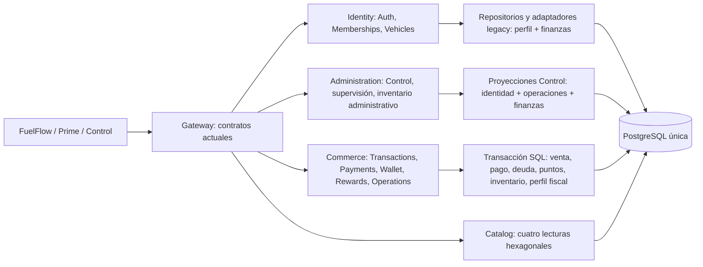

# Astra — Etapa 3E: fronteras Identity, Commerce, Catalog y Administration

Estado: **diseño, sin implementación ni autorización implícita de los lotes**.
Referencia: `1dcb5836ad2bbbb089c486eba2c9950ad05a2d55`, rama
`feat/dezkz-identity-a4-core`. Inspección estática del código y evidencias de 3D-B;
ninguna ejecución Docker, prueba, migración, conexión a datos o commit en 3E.
Se conserva una PostgreSQL, cuatro procesos NestJS, Gateway, FuelFlow, Prime y
Control, Docker Compose y el esquema existente. Kubernetes queda fuera de alcance.

## 1. Mapa de ejecución y dependencias actuales

Los entrypoints `Backend/src/apps/{identity,commerce,catalog,administration}/main.ts`
seleccionan módulos de negocio distintos. `bootstrapDomain` aún incorpora Prisma,
AuthCore, Alerts, Health y throttling comunes a los cuatro procesos. Disponer de
artefactos Docker distintos no delimita por sí solo los permisos SQL de cada proceso.
Este informe verifica configuración/fuentes; no certifica un despliegue en ejecución.

El diagrama representa consultas/llamadas locales y SQL actuales, no nuevos RPC.
Gateway envía `/memberships/me` y sus historiales a Identity, pero prioriza
`/memberships/me/wallet` y `/recharges` hacia Commerce. `/vehicles/:plate` sigue
en Identity; `/transactions`, `/authorizations`, `/rewards`, `/online-orders` en
Commerce. `/control/catalog/{stations,inventory}` va a Catalog, mientras el resto
de `/control` va a Administration salvo las excepciones de pagos/asistencia/
terminal-operations hacia Commerce. No cambiar esos destinos durante la extracción.

Puntos concretos de acoplamiento:

- MembershipsRepository en Identity consulta movimientos, autorizaciones, deudas,
  canjes y transacciones de Commerce; importa transactionInclude/transactionResponse.
- LegacyMembershipCommerce ya implementa un puerto de lectura, pero su cálculo y
  ejecución siguen locales a Identity sobre el repositorio común. Es una frontera
  lógica transitoria, no una llamada a un Commerce independiente.
- VehiclesRepository.findByPlate reúne propiedad, perfil y deuda; VehiclesService
  formatea dinero y datos identificativos en la misma representación pública.
- Commerce consulta Vehicle, Membership, User, Station, Fuel y Benefit dentro de
  sus transacciones, y escribe campos de Membership de varias responsabilidades.
- Administration crea cuentas User, modifica seguridad y consulta perfil/dinero
  para Control; su alcance deriva también de transacciones/autorizaciones.
- Alertas son dependencia global legacy: TransactionsController puede escribir una
  alerta antes del comando financiero; GET /admin/alerts también reconcilia alertas.
  Ninguno debe reclasificarse como lectura pura por su verbo HTTP.

## 2. Contratos acoplados: consultas, permisos y consistencia observada

| Contrato vigente | Consultas y cuerpo real | Autorización y límite a conservar |
|---|---|---|
| GET /api/v1/memberships/me | Membership.findUnique por userId, include user(name,email), vehicles y todos los escalares Membership. Después aggregate RewardMovement, FuelAuthorization y MembershipDebt; devuelve spread de membresía más resumen financiero. | Actor del guard, no userId de query. Guard valida cuenta/authVersion; sin membresía: 404. No añadir condición de membresía ACTIVE que hoy no se evalúa aquí. No proyectar únicamente los campos Swagger: se perderían campos reales. |
| GET /api/v1/vehicles/:plate | Normaliza placa; findUnique con membresía, aliases, user.name, balance, documentos y debts.amountPending. Devuelve id/plate/label y membership resumida o null; balance/pendingBalance fixed(2), legacyNumbers y datos fiscales. | MemberOrKiosk. Miembro ajeno y placa inexistente comparten 404. Firma/kiosco siguen sus validaciones específicas. El kiosco autorizado no tiene el mismo filtro de propietario que el miembro; no intercambiarlos ni ampliarlos. |
| GET /api/v1/memberships/me/transactions | Resuelve membresía propia; findMany con transactionInclude, createdAt desc/id desc, take/skip; transactionResponse retira requestHash y reduce membership, conserva relaciones y formato de comprobante. | Guard y PaginationDto vigentes. Arrays, page=1/limit=20, máximo 100; inválidos: 400. Sin filas: []; sin membresía: 404. |
| GET /api/v1/memberships/me/rewards | RewardMovement por membershipId propio, createdAt desc/id desc, take/skip. | Historial de movimientos de puntos, no catálogo de beneficios ni suma nueva. Misma validación y aislamiento. |
| GET /api/v1/memberships/me/redemptions | Redemption por membershipId, include benefit, createdAt desc/id desc, take/skip. | No generar cupón, descontar puntos ni recalcular coste durante la consulta. |
| GET /api/v1/memberships/me/wallet | Commerce: busca Membership dentro de atomic; luego movimientos (máximo 100), reservas y deuda fuera de esa transacción inicial. Resumen y movements con formatos fixed(2). | Actor propio, guard original. No asumir snapshot común para todas las consultas ni sustituirlo por me. |
| PATCH /api/v1/memberships/me/profile | Verificación de existencia, updateProfile en atomic con assertIdentity, luego vuelve a me. Actualiza DNI/pasaporte/RUC/razón social conforme DTO, no saldo. | El commit del perfil y la lectura enriquecida de respuesta son pasos separados. Una falla posterior de lectura puede ocurrir con el perfil ya actualizado; no añadir reintento de escritura ni prometer rollback del PATCH por esa falla. |
| POST /api/v1/rewards/redeem | Commerce: membresía y usuario activos, replay por operationId, Benefit activo/coste, suma de puntos, Redemption + RewardMovement negativo en la misma atomic. | Miembro propio; datos incompatibles de replay: conflicto. No desplazar a Catalog por usar Benefit ni sacar su lectura de la transacción. |

El listado GET /vehicles ya consolidado en 3D-B conserva su separación y no se
reabre. Tampoco se crea GET /profile o /users/me como atajo: serían contratos nuevos.

### Diferencias financieras que no deben uniformarse

`me` usa el balance obtenido con la primera lectura de Membership. Después ejecuta
balance(points), reserved y pending secuencialmente, sin transacción común:

- points = suma RewardMovement.points, cero sólo si el aggregate devuelve null.
- reserved = suma reservedAmount de autorizaciones RESERVED/DISPENSING, sin el
  filtro mode de WalletRepository. No añadir INTERVENTION_REQUIRED aquí.
- pendingBalance = suma MembershipDebt.amountPending, sin filtro de estado nuevo.
- balance/available = snapshot balance fixed(2), total = snapshot balance + reserved.

`wallet` sí filtra reservas POSTPAGO e incluye INTERVENTION_REQUIRED, además de
RESERVED/DISPENSING. `vehicles/:plate` suma la relación debts incluida en su consulta.
Son proyecciones distintas: no compartir una fórmula nueva que cambie resultados.
No paralelizar ni envolver las consultas de me en una nueva transacción como parte
de una refactorización de paridad. Mayor consistencia requeriría aprobación propia.

Los historiales incluyen relaciones vivas (p.ej. nombres de Fuel/Station y de
miembro); no todo el cuerpo es snapshot histórico. Los campos comerciales
persistidos y el comprobante emitido sí tienen reglas propias. Nunca recalcular
precio histórico desde GET /fuels ni regenerar UUID, recibos o números al consultar.

### Contratos de los tres clientes

Prime consume el cuerpo mixto de me, vehículos, historiales, beneficios/canjes y
wallet; conserva dinero string, puntos enteros, arrays y fallos de sesión/dependencia.
FuelFlow utiliza membership.balance/pendingBalance/number/legacyNumbers de la vista
por placa y snapshots del comprobante al vender/imprimir. Control utiliza vistas
administrativas distintas: permisos ADMIN_CUSTOMER_VIEW/MEMBERSHIP_VIEW/VEHICLE_VIEW/
TRANSACTION_VIEW/RECEIPT_VIEW y filtros por estación. No reemplazar esas vistas con
un endpoint privado de socio que ignore alcance o enmascarado.

ControlCustomersService deriva alcance de la existencia de transacciones o
autorizaciones en las estaciones autorizadas, no de una columna stationId del
perfil. Oculta/enmascara ciertos campos para no globales y condiciona las relaciones
a permisos adicionales. Un contrato genérico de finanzas/perfil no puede devolver
el mismo cuerpo a socio, kiosco y administrador sin esa política original.

## 3. Responsabilidades lógicas propuestas y escritores actuales

La columna «propuesta» no cambia tablas, permisos SQL, FK ni escritores hoy.
No hay todavía un escritor físico exclusivo de User o de toda Membership.

| Datos/efecto | Escritor o autoridad actual verificada | Responsabilidad propuesta y transición |
|---|---|---|
| User y credenciales | UsersRepository.register; PasswordResetService; ControlService crea User para personal y cambia active/authVersion al deshabilitar/rechazar. | Identity como dominio de cuenta; Administration solicita/gestiona altas y acceso. Mantener los comandos actuales hasta resolver autoridad de cuenta/A.2 y atomicidad de Control. No añadir otro escritor. |
| Identificadores, número/aliases y vínculo User–Membership | Registro crea User+Membership+contador mediante la transacción actual; algoritmos/aliases legacy ya existen. | Identity identificativo; UUID y referencias se conservan. Ningún algoritmo A.4 de laboratorio sustituye el registro. |
| Membership.status | Campo usado en elegibilidad por ventas, canjes, recargas y vínculo. No se deduce un nuevo dueño de suspensión de esos lectores. | Decisión de política pendiente; no moverla ni asignar prioridad absoluta a suspensión frente a comandos concurrentes. |
| Perfil Membership.dni/passport/ruc/businessName | Identity PATCH profile; Commerce también escribe dni/ruc/businessName por saveReceiptProfile. | Identidad lógica de perfil con excepción transaccional heredada explícita. Commerce conserva esa escritura hasta una migración aprobada de su unidad completa. |
| Vehicle y vínculo exclusivo | VehiclesRepository.link en Identity, con comprobaciones y atomic existentes; Commerce sólo referencia/consulta en los flujos revisados. | Identity mantiene comando y UUID; otros dominios consumen referencia autorizada. No copiar link a Commerce. |
| balance, deuda, WalletMovement, Payment/Event, Transaction, FuelAuthorization, RewardMovement, Redemption | Commerce y sus repositorios/helpers dentro de unidades financieras existentes; Identity y Control aún tienen lectores directos. | Commerce lógico financiero; separar puertos de consulta sin trasladar cálculos ni escritores al perfil. |
| welcomeAvailable/welcomeReservedOperationId/welcomeTransactionId | Registro inicializa welcomeAvailable; Commerce reserva/consume/libera bienvenida con pago/venta. | Efecto compartido de alta/fidelización actual; mantener default y transacciones. No declarar Membership completa propiedad exclusiva de un servicio. |
| Receipt y secuencias EB01/FT01 | Trigger PostgreSQL AFTER INSERT Transaction; protección de inmutabilidad. Lectura por Commerce/Identity/Control. | Emisión dentro del límite Commerce + DB; no asignación en Identity, frontend ni impresión. Rollback puede dejar huecos de secuencia: no prometer consecutividad sin huecos. |
| Fuel/Benefit y sus lecturas | Catalog lee; fuentes de inicialización Prisma contienen escrituras maestras. No se detectaron comandos operativos de edición de estos maestros en los módulos revisados. | Catalog para productos/combustibles/beneficios; autoridad de edición por definir si se habilita. No inventar CRUD ni asignar al lector una escritura nueva. |
| Station, Pump, Terminal y asignaciones | Lectura Station en Catalog; Control gestiona operaciones/asignaciones. Existen también comandos operational-admin de OperationsModule que hoy ejecuta Commerce. | Administration como gestión/configuración lógica; preservar escritor y unidad actual de cada comando. El prefijo administrativo no demuestra que ya se ejecute en Administration. |
| FuelInventory/Reservation/Movement | Commerce reserva/consume/libera; Administration registra entradas/reconcilia mediante funciones SQL; Catalog sólo lee. | Responsabilidades por comando, no traslado íntegro de tabla. Mantener locks, triggers, idempotencia y restricciones comunes. |
| Grants, cuentas Control y asignaciones | ControlService y comandos operativos existentes; AccessGuard los consulta junto con User. | Administración de permisos en Administration y verificación de identidad en AuthCore/Identity, con autoridad/acuerdo aún pendiente. No migrar grants ni cachear autorización. |
| BusinessAlert y dashboard | AlertsService compartido, rutas admin expuestas por Identity; Commerce lo invoca. GET alerts reconcilia deuda y escribe; dashboard consulta ventas. | Administration como responsabilidad lógica de gestión/reportes, con datos Commerce; conservar el host actual hasta aprobar migración. |

### Unidades que permanecen enteras y en su ejecutor actual

1. Registro User + Membership + número/contador y defaults de bienvenida.
2. Reset PasswordReset consumido + passwordHash + incremento authVersion. A.2 es
   un bloqueo propio; el cierre académico A.4 no lo resuelve ni autoriza cambios.
3. Control alta: User + cuenta aprobada + grants + estaciones + auditoría;
   desactivación/rechazo: estado de cuenta + cambios de User/authVersion +
   revocación/fin de asignaciones + auditoría en la transacción actual.
4. Vehicle link: membresía/usuario elegibles, propiedad exclusiva, UUID y etiqueta.
5. Commerce: autorización/reserva, avance/cierre de inventario y liquidación de
   venta/pago/deuda/puntos/comprobante; recarga + liquidación FIFO; canje + débito;
   confirmaciones/refunds/bienvenida y sus reglas actuales.
6. Emisión/rotación/recuperación de credenciales técnicas con sus locks y evidencia
   operacional; no separar por tabla Terminal ni activar recibos/cuarentena A.4.

Los `atomic` que usan PrismaService conservan Serializable, timeout/maxWait y
reintentos actuales. No generalizar esa configuración al registro `$transaction`
sin opciones explícitas, ni añadir reintentos remotos por semejanza de nombres.
La unidad SQL no garantiza atomicidad con un proveedor de pago, SMTP o Redis.
T01 sigue como incidencia conocida de finalización, sin acción compensatoria.

## 4. saveReceiptProfile: frontera crítica

En TransactionsService.create, el requestHash incluye datos de comprobante y
`saveReceiptProfile === true`. La operación requiere autorización previa, valida
operationId/contexto técnico, vehículo, membresía/código, estación y combustible,
estado/avance/precio histórico e inventario según el flujo vigente.

Dentro del mismo `repo.atomic(tx)`:

1. Busca replay por operationId y compara requestHash y contexto. Si ya existe,
   devuelve el resultado anterior antes de guardar perfil de nuevo.
2. Valida/ajusta liquidación, bienvenida, pago y reserva según modo existente.
3. Calcula receiptDni/Ruc/BusinessName desde DTO o perfil según BOLETA/FACTURA.
4. Con saveReceiptProfile exige elegibilidad y código; assertIdentity valida
   DNI/pasaporte. Actualiza sólo los valores truthy de dni/ruc/businessName en
   esa Membership por su UUID acreditado, no por userId libre del cliente.
5. Crea Transaction con snapshots fiscales, Payment/deuda/puntos pertinentes;
   el trigger emite Receipt. Cierra la reserva de inventario cuando corresponda.
6. Confirma todo o revierte las escrituras SQL de esa unidad. Restricciones
   únicas/FK y fallos posteriores también afectan al perfil guardado en ella.

Por tanto, **Commerce conserva saveReceiptProfile en su transacción actual**.
No convertirlo en HTTP a Identity antes del commit (perfil podría sobrevivir a
venta fallida), después (venta podría sobrevivir a perfil fallido) ni en un evento
asíncrono (cambiaría éxito/consistencia/replay). Tampoco quitarlo, ignorarlo o
reaplicar el perfil al consultar/reintentar una venta ya confirmada.

Alternativas comparadas:

| Alternativa | Garantía/decisión |
|---|---|
| Conservar implementación actual; puerto local transaccional si se extrae | Recomendada inicialmente. Un único ejecutor y misma conexión/tx; no añade escritor ni cambia resultados. |
| Helper de perfil acotado al contexto SQL opaco del coordinador Commerce | Posible futura separación de código. Debe usar la misma tx, validaciones y replay; no equivale a escritor exclusivo Identity ni autonomía de proceso. |
| Mover unidad completa a otro ejecutor | Requiere migrar toda la transacción, autoridad, contratos, errores y recuperación. No está aprobado ni es un simple cambio de perfil. |
| HTTP/outbox/saga para perfil y venta separados | No preserva automáticamente atomicidad inmediata. Requiere aceptar otro contrato operativo y mecanismos nuevos; excluida de los lotes de paridad. No se propone infraestructura productiva ahora. |

El PATCH de perfil y saveReceiptProfile son escritores existentes concurrentes.
No elegir una prioridad nueva entre ellos ni introducir versiones/merge automático.
Conservar los campos, null/omisión/truthy, restricciones y conflictos actuales;
cualquier política de resolución necesita decisión expresa y pruebas propias.

TransactionsController.checkAuthorization puede escribir BusinessAlert **antes**
de entrar a TransactionsService.create. No incluir esa alerta en una promesa de
rollback de la venta ni moverla dentro de atomic para mejorar el diseño sin permiso.

## 5. Contratos hexagonales propuestos (internos, no nuevos HTTP)

Primera composición: puertos TypeScript puros y adaptadores legacy locales;
ningún Prisma.TransactionClient, Nest decorator, Request/Response o JWT_SECRET
en aplicación. No exponer passwordHash, resetToken ni claves en proyecciones.
Los nombres siguientes son contratos de diseño, no archivos ya implementados.

| Puerto | Entrada acreditada y salida | Adaptador inicial / límites |
|---|---|---|
| OwnMembershipOverviewRead | userId del actor; cuerpo legado íntegro de me | Adaptador usa findForUser y LegacyMembershipCommerce en el orden actual. No llamar al me de una fachada que ya delegue al caso de uso: evitar recursión. |
| OwnMembershipHistoryRead | userId confiable + page/limit validados; métodos transactions/rewards/redemptions, arrays legados | Repositorio y mappers existentes. Resuelve membresía antes de consultar; no aceptar membershipId de query como autoridad. |
| VehicleLookupRead | placa normalizada y actor vigente; proyección legada o error de ocultación | Reutiliza consulta/enriquecimiento original y su comprobación de propiedad antes de devolver finanzas/documentos. |
| IdentityProfileRead | userId/membershipId/vehicleId correlacionados, proyección identificativa autorizada | Reutilizable en una separación posterior. PrismaMembershipProfiles existente omite campos del cuerpo público actual y no es sustituto directo de me. |
| CommerceMembershipRead | membershipId acreditado y tipo de proyección explícito MeLegacy/WalletLegacy/VehicleLegacy; strings decimales y puntos según cada contrato | Conserva algoritmos/filtros distintos en adaptadores. No crea una calculadora financiera en Identity ni una respuesta cero por caída. El puerto CommerceMemberships ya existe y puede ampliarse deliberadamente. |
| AuthorizedControlRead | actor/permiso/estaciones confiables + filtros; proyección de Control con redacciones actuales | Adaptador ControlCustomers actual, separado de las vistas de socio/kiosco. No confiar en stationIds enviados por frontend. |
| AtomicReceiptProfileWrite | contexto transaccional opaco y campos ya acreditados por el cierre; resultado interno, no comando autónomo público | Sólo la misma unidad Commerce. Adapter contiene Prisma/validación legacy; prohibido usarlo tras el commit o transportar ese contexto por HTTP. |
| CatalogReferenceReadInTransaction | IDs de Fuel/Station/Benefit y contexto de la operación; datos validados dentro de tx | Conserva SELECT actuales dentro de venta/canje. No reemplazar por catálogo HTTP precargado/caché para decidir coste o elegibilidad atómicos. |

La primera variante de lectura puede encapsular el cuerpo legado completo en un
adaptador y un caso de uso de paso, sin fingir que ya separó datos o ejecución
financiera. Después de aceptar paridad podrán estrecharse proyecciones internas.
No copiar algoritmos monetarios para poblar un modelo «limpio» ni borrar campos.

### Transporte y consistencia: condiciones antes de un adaptador remoto

Un proceso Commerce remoto no participa en una transacción Prisma abierta por
Identity aunque ambos apunten a la misma PostgreSQL. No pasar un ID de tx por
HTTP ni afirmar atomicidad distribuida por compartir base. Para lecturas futuras
se necesitan identidad técnica del servicio y sujeto autorizado, política explícita
de revocación/alcance, error mapping compatible, disponibilidad y presupuesto de
latencia. No se selecciona protocolo, claves nuevas ni infraestructura ahora.

Mantener autorización actual por petición. Actor tipado no acredita por sí solo
un actor recibido de la red; no confiar en x-user-id ni payloads Actor públicos.
Un resultado/recibo histórico no concede permisos actuales. Ante fallo no retornar
saldo cero, perfil de otro usuario ni caché ajena. No añadir 503 al contrato sólo
porque el nuevo transporte lo produzca: ese mapeo debe compararse y aprobarse.

No añadir asOf/versiones al cuerpo público. Un sello horario de respuesta no
demuestra snapshot común; los lectores actuales no lo ofrecen. Si se desea una
proyección atómica o caché con antigüedad acotada, definir primero sus consecuencias
y aceptación. No fijar plazos arbitrarios de validez o revocación.

## 6. Plan agrupado de consolidación (sólo propuesta)

### Lote R — cinco lecturas protegidas, paridad local; riesgo medio

- Operaciones: GET memberships/me, vehicles/:plate y los tres historiales
  transactions/rewards/redemptions. Mantener listado vehicles de 3D-B intacto.
- Archivos/módulos: MembershipsService/Module/Repository (usar consultas sin
  cambiarlas), VehiclesService/Module/Repository, identity-adapters/membership-commerce,
  transaction.model/receipt.service como dependencias intactas; nuevas piezas en
  Backend/services/identity/src/{application,adapters,bootstrap}. Sólo ajustar
  Dockerfiles/tsconfig si el grafo realmente lo requiere. Controladores sin cambios.
- Dependencias: Actor/guard existentes, LegacyMembershipCommerce y mappers;
  contratos congelados de cuerpos/orden/errores. MembershipOverview experimental
  no es drop-in: devuelve profile/finance separados. No activarlo ni usar A.4.
- Riesgos: pérdida de campos, redondeos, cambio de filtros o secuencia de consulta,
  filtración por placa/UUID, consulta duplicada, recursión de fachada y efecto en
  PATCH profile que llama me después del commit.
- Pruebas: paridad anterior/nueva con dos propietarios, kiosco permitido/rechazado,
  aliases, placas ajenas e inexistentes, nulos, membresía ausente/suspendida según
  conducta previa, todos los estados financieros leídos, paginación y UUIDs/fechas;
  regresión PATCH sin cambiar su comando, errores de lectura posteriores al commit;
  PostgreSQL/Redis sintéticos nuevos y mocks de fallos, fingerprints de sólo lectura.
- Aceptación: cinco rutas y todos los campos/errores/filtros idénticos, consultas
  financieras sólo en adaptadores legacy, ninguna nueva llamada HTTP o escritura,
  guard y código financiero intactos; builds cuatro servicios/legacy y Docker.
- Reversión: revertir únicamente el futuro commit de ese lote y reutilizar
  artefactos anteriores, sin DDL ni borrado de datos. Requiere nueva autorización
  explícita del lote; técnicamente no depende de resolver A.2 para conservar el guard.

### Lote P — frontera de perfil y escrituras compartidas; riesgo alto, bloqueado

- Operaciones: PATCH memberships/me/profile y el efecto saveReceiptProfile en
  POST transactions, tratados conjuntamente para el análisis de escritores.
- Archivos: memberships/profile.dto, memberships.repository/service, transactions.service,
  create-transaction.dto, transactions.repository, prisma/prisma.service como
  dependencias; futuros puertos Identity/Commerce sin modificar schema/validaciones.
- Dependencias: decisión de autoridad por campo, aceptación de la excepción
  Commerce y alcance autorizado de escrituras. No abrir un segundo escritor.
- Riesgos: venta y perfil parcialmente confirmados, rollback perdido, replay que
  sobrescribe un perfil posterior, concurrencia DNI/pasaporte/RUC, P2002 y orden
  con suspensión. No atribuir a Identity prioridad sobre una tx financiera.
- Pruebas: inyección de fallo después del guardado de perfil, después de insertar
  venta y antes de cerrar inventario; rollback conjunto y replay idéntico sin
  reescritura; flag/parámetros diferentes: conflicto; DTO null/omisión/truthy;
  carrera con PATCH usando únicamente copias sintéticas y permisos explícitos.
- Aceptación: mismo resultado financiero y fiscal, mismos locks/reintentos y
  snapshot de comprobante; permanece ejecutor Commerce para el cierre. Un puerto
  local sólo es aceptable si utiliza la misma tx y no copia reglas.
- Reversión: sólo código del futuro lote mientras no haya migración de datos.
  Mover autoridad física o introducir outbox/saga queda fuera y requiere otro diseño.

### Lote C — unidades financieras hexagonales de Commerce; riesgo alto, bloqueado

- Operaciones agrupadas por unidad: autorización/reserva/progreso/cierre y pagos;
  recarga/liquidación FIFO; canje/débito. Lecturas wallet/transactions pueden
  envolverse localmente antes, pero no anuncian propiedad financiera independiente.
- Archivos: services/commerce/src futuro, transactions/*, wallet/*, payments/*,
  rewards/*, inventory/inventory-reservations y funciones/triggers SQL existentes
  como dependencias que no se modifican para facilitar la extracción.
- Dependencias: autorización específica Commerce; mapa de operaciones atómicas
  y recuperación; datos de referencia leídos en la misma tx, idempotencia/contexto.
- Riesgos: doble cobro/canje, pérdida de reserva, divergencia ledger/deuda/Payment,
  cambio de precio histórico, descuentos repetidos, recibos recreados; SQL y proveedor
  externo no forman una sola transacción. Un timeout remoto no acredita rollback.
- Pruebas: critical-integrity, wallet, rewards, authorizations, recibos y reservas;
  concurrencia/fallos/reinicio/replay en base nueva; mismos UUID y referencias.
- Aceptación: coordinador invoca un puerto de unidad atómica completo, adaptador
  usa el motor legacy una sola vez; no se distribuyen los pasos por HTTP. Política
  monetaria, inventario, requestHash y secuencias sin cambios.
- Reversión: conmutar artefacto/código del lote, sin compensaciones ni limpieza
  financiera automática. T01 original no se usa para probar esa reversión.

### Lote G — autoridad de cuenta, permisos y operaciones administrativas; bloqueado

- Operaciones: registro/reset/revocación, altas/bajas/aprobaciones de Control,
  grants/asignaciones y credenciales técnicas. Gestión operacional actualmente
  servida desde Commerce se inventaría antes de decidir un traslado a Administration.
- Archivos: auth/*, users/*, control/control.service y módulos, operations/*,
  kiosk/* y puertos experimentales sólo como referencia de diseño.
- Dependencias: decisiones AuthCore/A.2, dueño de cuenta/authVersion y delegación
  de permisos, misma tx de aprovisionamiento/desactivación, límites de estación.
- Riesgos: cuentas huérfanas, grants vigentes tras baja, pérdida de auditoría,
  prioridad de revocación inventada, recuperación que acepte autoridad histórica.
- Pruebas: cuenta+grants+auditoría all-or-nothing, baja frente a uso concurrente,
  reset de uso único y fallos, restricciones por estación y datos enmascarados;
  requieren autorización y laboratorios nuevos, no extensión automática de A.4.
- Aceptación: una autoridad lógica acordada por comando y misma garantía de commit;
  ningún JWT/cookie/permisos cambia sin aprobación. No basta mover carpetas.
- Reversión: plan específico de código y compatibilidad de credenciales aprobado
  antes del lote; no revertir authVersion ni resucitar grants para «volver atrás».

R puede avanzar como siguiente lote de refactorización una vez autorizado.
P/C/G son diseños diferidos; no se condiciona cerrar el lote R a inventar nuevas
fases experimentales. La separación remota de lectores también queda condicionada
a los acuerdos de autorización/consistencia/transporte anteriores.

## 7. Matriz de validación futura y evidencias de aceptación

No se ejecuta ninguna fila en 3E. Son requisitos para futuras autorizaciones.

| Frontera | Comprobación necesaria | Evidencia de salida |
|---|---|---|
| me y vistas compuestas | JSON completo, Decimal strings/ISO/null/aliases, fórmulas y filtros distintos preservados; mismo orden de consultas | Comparador legacy/nuevo, casos financieros sintéticos, query traces saneadas sin PII/secretos |
| Historiales | Orden createdAt/id, take/skip, arrays vacíos, permisos y FK/receipt sin recreación | Golden contracts y datos PostgreSQL nuevos antes/después |
| Aislamiento | A/B, token inválido/vencido/versión anterior, placa ajena 404, kiosco y Control con sus alcances propios | Matriz negativa HTTP con JWT/guard reales y recursos aislados |
| Perfil/venta | Rollback de la unidad SQL y replay sin reaplicar perfil; conflitos de unicidad/contexto | Failpoints y fingerprints de todas las tablas afectadas; mismos IDs/recibos; huecos de secuencia aceptados según contrato actual |
| Administration | Altas/bajas y permisos atómicos, estación ajena, redacciones y no globales | Casos Control y auditoría sintética; ningún campo extra visible |
| Commerce | Reserva/pago/ledger/deuda/canje/comprobante coherentes y sin dobles efectos | Suites financieras existentes más carreras/fallos autorizados; no pagos reales |
| Contratos de clientes | Prime/FuelFlow/Control conservan sus respuestas y reacciones a errores | Tests existentes de servicios/UI y comparación de flujos en stack sintético cuando se autorice |
| Empaquetado | Cuatro builds, legacy, entrypoints y módulos esperados; arranque/health sin seeds operativos accidentales | Manifiestos y Docker builds; integración sólo Compose exclusivo revisado |
| Reversión | Artefactos antiguos usables y ningún DDL o compensación imprevista | Plan y prueba en copia; evidencias previas intactas |

Referencias de pruebas existentes que deben seleccionarse y revisar scripts antes
de ejecutar: transactions/{transactions.service,critical-integrity,authorizations.service}.spec.ts,
wallet/wallet.service.spec.ts, rewards/{rewards.service,points-policy.service}.spec.ts,
identity-adapters/membership-commerce.spec.ts, vehicles/vehicle-list-hexagonal.spec.ts,
control/control-customers-scope.spec.ts, Backend/gateway/routes.test.cjs y los
tests de clientes. Una suite histórica no demuestra validación de este diseño.

## 8. Decisiones pendientes y conclusión

1. Aprobar o ajustar lote R completo, sin autorizar P/C/G por arrastre.
2. Ratificar excepción transaccional saveReceiptProfile en Commerce mientras no
   se migre una unidad completa. Un objetivo «Identity único escritor físico»
   es incompatible con mantener esa escritura actual sin una decisión adicional.
3. Acordar autoridad de User/authVersion, grants y Membership.status con AuthCore,
   A.2 y Administration. No suponer una prioridad absoluta de revocación/suspensión.
4. Decidir si habrá separación remota de lecturas y qué consistencia, fallos,
   permisos y latencia son aceptables. Compartir PostgreSQL no resuelve esos puntos.
5. Definir autoridad de edición de maestros Catalog/Station sólo si se van a
   habilitar comandos; conservar exposición pública de inventario sin ampliarla.

La ruta corta recomendada es **un lote agrupado de cinco lecturas con adaptadores
locales de compatibilidad**, seguido de revisión explícita de las fronteras de
escritura. No trasladar tablas, transacciones o claves para obtener una apariencia
de independencia. Se preservan PostgreSQL única, FK, UUID, comprobantes, tres
frontends y Gateway. Los riesgos principales están en la atomicidad de Commerce,
la autoridad de cuenta de Administration y la consistencia de vistas mixtas.

Se mantiene el cierre académico A.4 y T01 sin cambios. En 3E sólo se crea este
documento de diseño; no se crean commits, cambios operativos, pruebas ni recursos.
